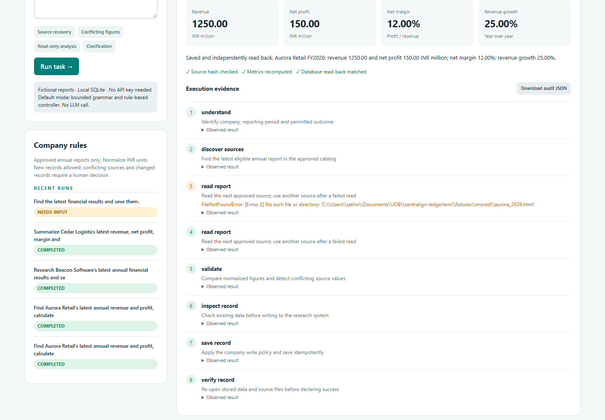
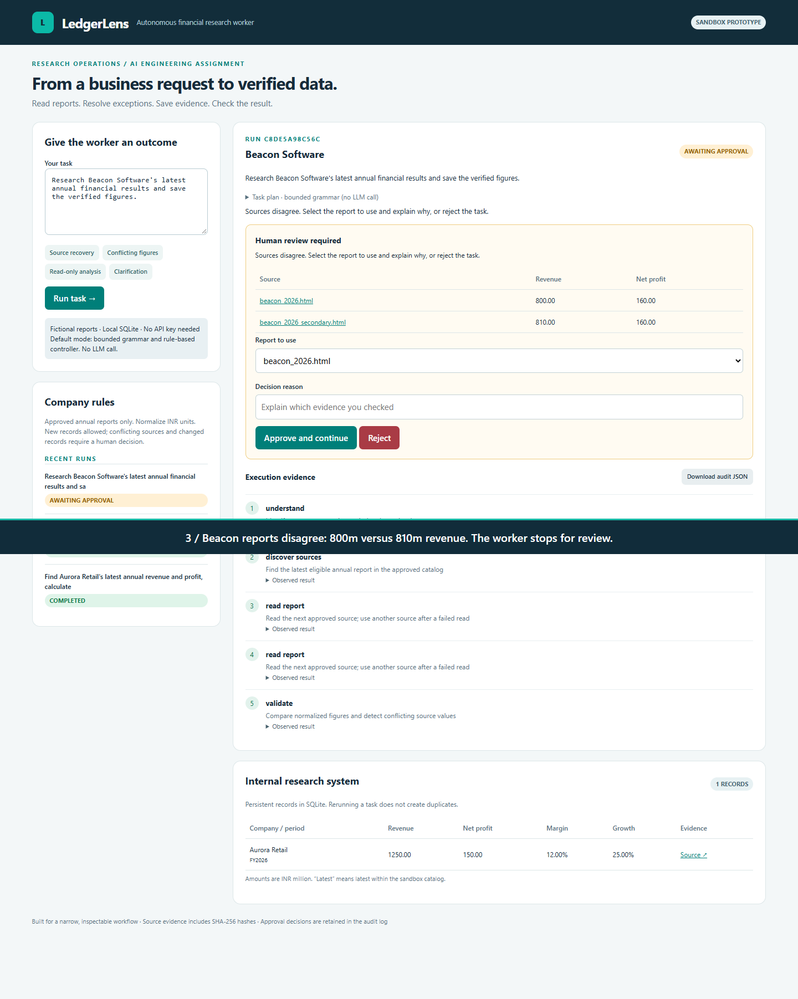
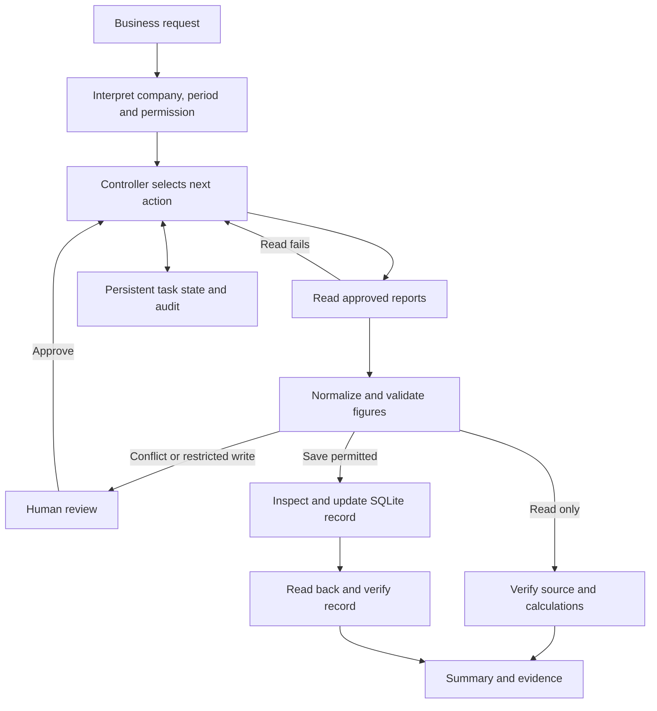

# LedgerLens

### Financial research that ends with verified data.


[Watch the demo](artifacts/demo.webm) · [Architecture](docs/ARCHITECTURE.md) · [Test evidence](artifacts/evidence/unit-tests.txt) · [Technical guide](docs/TECHNICAL_GUIDE.md)

A bounded autonomous financial research and data quality worker, prepared for the CentrAlign AI Engineering Intern assignment.



Give it an outcome such as **“Find Aurora Retail's latest annual revenue and profit, calculate margin and growth, and save the research record.”** It selects approved reports, extracts and normalizes financial figures, handles missing or conflicting sources, writes to SQLite, and independently checks the saved result.

**Scope disclosure:** companies and source reports are fictional sandbox fixtures. File reads, calculations, persisted state, database writes, approvals, and verification are real. The default interpreter and controller are rule-based; no LLM is called in the supplied demo. An optional Ollama task-interpretation adapter is included, but no real-model integration run is claimed. This is a bounded autonomous workflow, not a general computer-use agent.

**Supported companies:** Aurora Retail, Beacon Software and Cedar Logistics. Arbitrary real-company lookup and live financial research are not implemented.

## Working demo and validation

**[Watch the 79-second recorded demo](artifacts/demo.webm)**. Download the WebM file if GitHub does not offer inline playback.

The supplied local run passed **25 automated tests** and **six browser scenarios**. These are results for the bundled test cases, not a production accuracy claim or a GitHub Actions result.

| Scenario | Observed behavior |
| :--- | :--- |
| Missing source | A real file-read failure triggers another approved source |
| Repeated task | Identical values produce no duplicate record |
| Conflicting sources | Execution pauses for a source choice and approval reason |
| Read-only task | Metrics are calculated without saving a record |
| Missing company | The worker requests clarification |
| Verification | Source evidence and saved values are rechecked before completion |

[Browser check results](artifacts/evidence/browser-checks.json) · [Recovery audit](artifacts/evidence/aurora-recovery.json) · [Approval audit](artifacts/evidence/beacon-approved.json)

<details>
<summary>View the human approval screen</summary>



</details>

## Quick start

Install Python 3.11 or newer, open a terminal in this directory, and run:

```sh
python server.py
```

Open **http://127.0.0.1:8765** in a browser. On Windows, `py -3 server.py` or `run_windows.bat` also works if Python is installed. No pip packages, API keys, paid services, or internet access are needed for the default application.

Run the checks in another terminal:

```sh
python -m unittest discover -s tests -v
```

For a command-line-only run:

```sh
python worker.py "Research Aurora latest financial results and save them"
```

The CLI prints a full audit JSON. Use the browser for approvals. To open the same state in the browser, launch `server.py` without changing the database path.

## Try these tasks

| Task | Expected behavior |
|---|---|
| Find Aurora Retail latest revenue and profit and save them | Missing primary source -> alternate report -> calculate -> save -> verify |
| Save Aurora latest financial results again | Existing identical values -> no duplicate -> verify |
| Research Beacon Software latest financial results and save | Sources disagree: 800 vs 810 million revenue -> human source selection -> continue |
| Summarize Cedar Logistics latest financial results. Do not save | Normalize lakh to million, preserve loss, produce summary without a database write |
| Save Aurora FY2025 financial results | Select explicit annual period rather than latest |
| Find latest financial results and save them | Ask for a company; no write |

In the Beacon review, inspect both reports, select the primary report, and enter a reason such as “Checked the sandbox primary annual report; use its 800 million figure.” Approving is a human exception decision, not proof of real-world correctness. Rejecting stops the run.

Supported intent is one company, one annual period or latest, and summary or save. A new task provides clarification after `needs_input`. An interrupted `running` task can be resumed from history with **Resume interrupted run**.

## Architecture



`Worker.next_action()` chooses one tool from the current state. A failed file read changes the next source. Conflicting observations pause the run. Read-only requests bypass write tools. Existing equal records use a no-op; changed records require approval. Completion is set only after source checks and, for writes, an independent database read.

## Design and source map

The [architecture notes](docs/ARCHITECTURE.md) explain controller decisions, state transitions, approvals and verification. The [technical guide](docs/TECHNICAL_GUIDE.md) includes the detailed design rationale, dependencies, assumptions and two-week roadmap.

```text
worker.py                 Interpreter, controller, tools and SQLite storage
server.py                 Local API and background execution
web/                      Browser interface
config/                   Company policy and aliases
fixtures/                 Fictional reports and approved source catalog
tests/                    Functional and reliability checks
docs/                     Architecture, design and demo instructions
artifacts/                Demo video, screenshots and execution evidence
scripts/record_demo.cjs    Browser recording and assertions
.github/workflows/        GitHub Actions test workflow
```

The worker uses file and database tools. Playwright verifies and records the UI; it is not the worker's execution engine. The GitHub Actions workflow runs tests on pushes and pull requests; inspect its actual result after upload.

## Tools and assistance disclosure

Runtime: Python 3.11+ standard library, SQLite, and vanilla HTML/CSS/JavaScript. Development: Python `unittest`, Playwright for browser verification and recording, and ReportLab for the separately supplied handbook. No runtime framework or external service is required.

An optional Ollama adapter proposes a task interpretation that must match the safe grammar. It does not expand the current language coverage, and it was not exercised with a real model in the supplied evaluation.

OpenAI Codex/ChatGPT provided substantial assistance with code, tests, documentation and demo tooling. No existing agent application or framework was copied. All report data is fictional.

## Limits and next steps

This version supports a known HTML schema, annual INR metrics and a limited task vocabulary. It does not research arbitrary websites, parse general PDFs, learn company policy automatically or provide authenticated approvals. Source hashes establish consistency, not authenticity. Failed verification after a write does not automatically roll back the record. The server is designed for local use.

Next: build a labelled evaluation set, add one authorized real-report connector, evaluate schema-constrained model interpretation, then add authenticated approvals, staged writes and a durable job queue. See the [full limitations and two-week plan](docs/TECHNICAL_GUIDE.md#assumptions-and-limitations).

For demo narration and reproduction instructions, see [the demo guide](docs/DEMO_SCRIPT.md).
